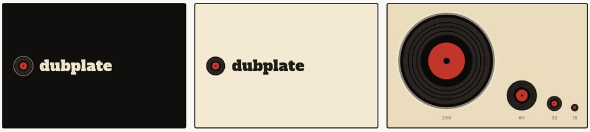
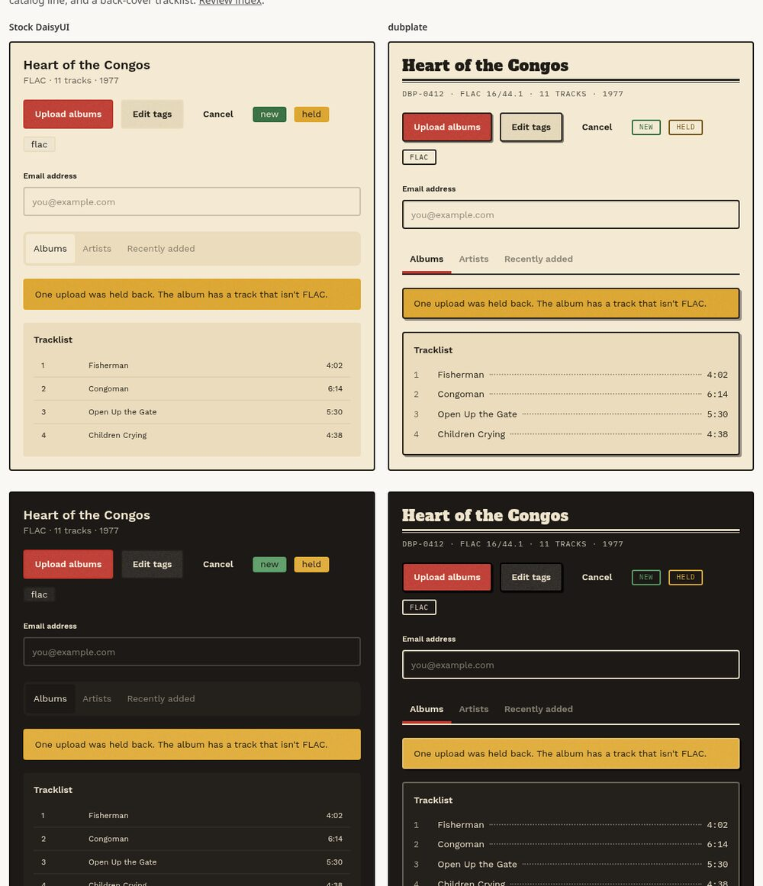
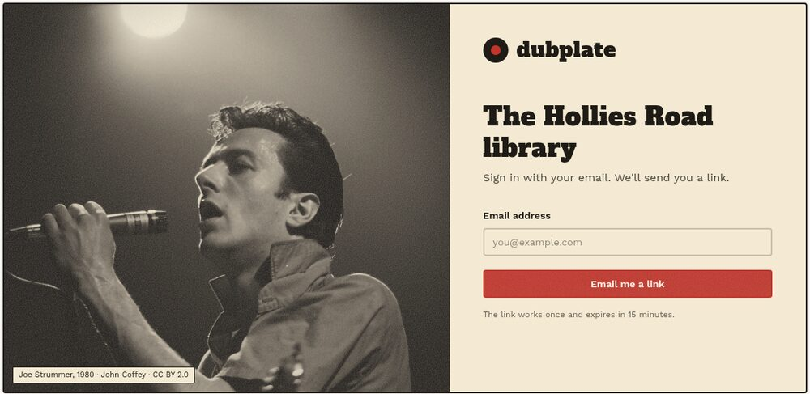

# dubplate visual identity

Status: revision 1, 2026-09-24, drafted from a live design session with Geoff. It awaits his
review. This spec authors the look that the web surface standard
(`2026-09-12-web-surface-standard.md`, W below) leaves open in W1.1 ("Rung 7 authors the look"),
and it lands inside the mechanisms the design-language standard
(`2026-09-07-design-language-standard.md`, DL below) already fixes. It decides the palette, the
type, the mark, how albums and photographs appear, the component layer that keeps dubplate from
reading as a stock DaisyUI app, and the copy register. It does not change a mechanism. Where a
choice touches a W or DL clause, the section says which one.

The direction in one sentence: a warm record shop crossed with a 1960s and 1970s dub studio,
built from the physical world of records (labels, sleeves, run-out grooves, catalog numbers,
darkroom prints), and never from wordplay about it.

The session's mockups live in `.superpowers/brainstorm/` (gitignored). The figures committed
beside this spec contain no third-party album art. The research behind the photography section
is in `docs/superpowers/research/2026-09-24-identity-photos/`.

## Owner rulings

Geoff made every ruling below on 2026-09-24, in order.

1. The direction is the record-shop "label" look, with a 1960s and 1970s dub-studio feel.
2. Albums appear as a sleeve with the record peeking out.
3. Depth is a hard printed shadow plus paper grain on sleeves.
4. Copy is plain and warm. Record-shop puns are out, and the login heading is the group's name.
5. The login page shows a rotating period photograph as a warm, grainy black-and-white print.
6. Photo captions sit on a film edge.
7. The photo rotation leans on deep cuts. Its core is reggae, dub, dancehall, and ska, plus punk
   and protopunk, and it spreads out from there, internationally. There is at most one image per
   headline artist, and only one Bob Marley image.
8. A dark theme exists: the label printed in reverse.
9. Shipped photos carry only licenses that permit redistribution. Operators add their own photos,
   and non-commercial photos never ship in the binary.
10. The mark is a record with a smooth lead-in and run-out, track bands at large sizes, and a
    38% label.
11. dubplate must not read as a generic DaisyUI app, so it adds the component layer described
    below. Its shadows are small, hard-edged, and printed at reduced strength.
12. Badges are squared outlines.
13. Photos also appear on a credits gallery, the empty library, and error pages.
14. Photo curation, including flyers and zine covers, is a separate pass with no fixed cap.

## Themes

The two-axis model in DL stays. One structural match block, `dubplate`, composes with two
palettes, `label` and `label-night`, giving the composed identities `dubplate-label` and
`dubplate-label-night` (DL R3.6). Pass 5c-ii's Task 4 lands these values as data files. The
build conductor committed the draft at `docs/superpowers/research/2026-09-24-visual-identity-draft-tokens.md`,
and this section supersedes it.

The `dubplate` match block sets every corner square, including selectors (the 2rem selector
radius from the first draft is withdrawn):

```css
--radius-selector: .25rem; --radius-field: .25rem; --radius-box: .25rem;
--size-selector: .25rem; --size-field: .28125rem;
--border: 2px; --depth: 0; --noise: 1;
```

`--size-field` is `.28125rem` so a default button measures 45px and clears DL R3.7's 44px touch
floor. The value is one of the steps DaisyUI's theme guidance offers for larger fields.

The `label` palette (`color-scheme: light`):

| Name | Value | Content |
|---|---|---|
| base-100 / 200 / 300 | `#f4ead3` / `#eadcbc` / `#dccaa3` | base-content `#1f1b16` |
| primary | `#c1352b` | `#fff6ea` |
| secondary | `#e0a526` | `#1f1b16` |
| accent | `#2f6b3a` | `#f4ead3` |
| neutral | `#1f1b16` | `#f4ead3` |
| info | `#2e5f8a` | `#ffffff` |
| success | `#2f6b3a` | `#ffffff` |
| warning | `#e0a526` | `#1f1b16` |
| error | `#a8261d` | `#ffffff` |

The `label-night` palette (`color-scheme: dark`):

| Name | Value | Content |
|---|---|---|
| base-100 / 200 / 300 | `#1c1916` / `#24201c` / `#342e28` | base-content `#efe4cc` |
| primary | `#c1352b` | `#fff6ea` |
| secondary | `#e5ad33` | `#1c1916` |
| accent | `#5a9e66` | `#1c1916` |
| neutral | `#110f0d` | `#efe4cc` |
| info | `#6d9cc7` | `#1c1916` |
| success | `#5a9e66` | `#1c1916` |
| warning | `#e5ad33` | `#1c1916` |
| error | `#e0604f` | `#1c1916` |

Every fill and its content color pass 4.5:1 in both palettes, and base-content passes 10.6:1 or
better on every base. Three colors fail as text on the page ground and are handled as follows:

- `label` warning as text measures 1.83:1. Warning text uses the measured ink `--ink-warning:
  #765000` (6.02:1 on base-100, 5.30:1 on base-200). It is not for text on base-300 (4.46:1).
- `label-night` primary as text measures 3.18:1. Red text and links on the dark theme use
  `--ink-primary: #ec7b6a` (6.34:1 on base-100, 4.85:1 on base-300), never `--color-primary`.
- `label` secondary and `label-night` neutral are fill-only and carry W2.6's exception marker.
  Neutral is the header bar and the shadow color, never text.

The inks live outside the DaisyUI blocks, so DL R2.1's 21 names are unchanged (W2.6).

With no cookie, the server stamps `dubplate-system`, whose stylesheet carries `label` values
unconditionally and `label-night` values under `@media (prefers-color-scheme: dark)`. The
adopter-facing setting is `DUBPLATE_THEME_PALETTE=system`. Every document carries
`<meta name="color-scheme" content="light dark">`. The theme-color metas use neutral:
`#1f1b16` for light and `#110f0d` for dark, as a `media` pair when following the system, and
as one value matching the stamped palette when the cookie overrides it. The theme toggle is an
icon-only DaisyUI `swap` (sun and moon, accessible name "Dark theme") at the right end of the
signed-in header's nav. The login page has no toggle. Choosing either state writes the
`__Host-dubplate_theme` cookie. Returning to "follow the system" belongs to a later settings
page.

## Type

Three OFL faces, embedded as three woff2 files under DL R5. Work Sans is one variable file, and
IBM Plex Mono ships one weight (400), so the three together take three of R5.4's four files:

| Face | Role |
|---|---|
| Alfa Slab One | Page titles and section headings (h1, h2), and the wordmark. Never body copy, never below the h2 size. |
| Work Sans | Everything else: body, labels, controls, and h3 and smaller headings in semibold. |
| IBM Plex Mono | Data only: catalog lines, durations, badges, photo captions, and technical metadata. |

A fourth face, Permanent Marker (OFL), is permitted in exactly one place: the album title
handwritten on the cream label of a record whose album has no cover art, the way an engineer
labels a test pressing. It never appears in the chrome, the wordmark, or headings. It is
the fourth and last woff2 file R5.4 allows, so no further face can join without a DL
erratum.

## The mark

The mark is a black record with a red label, drawn from the physical record rather than a
generic disc glyph. The wordmark "dubplate" sits beside it in Alfa Slab One, lowercase.



The geometry, in a 32-unit view box, is committed as three SVGs beside this spec:

- A 15.2-unit disc of smooth vinyl (`#0b0a09`) with a cream rim at 55% opacity. The rim keeps
  the record's edge readable on a black header.
- A grooved band (`#302a25`) from radius 13.7 in to the run-out, with twelve fine grooves. The
  smooth lead-in outside it and the smooth run-out inside it are darker, which is what makes the
  circle read as vinyl.
- A red label at 38% of the record's diameter (radius 5.8) and a smooth spindle hole.
- Three dark track bands in the grooved band, spaced unevenly like real song lengths.

The mark renders at three detail levels: `mark-large.svg` (56px and up, with track bands),
`mark-medium.svg` (21 to 55px, grooves without bands), and `mark-small.svg` (20px and below:
the disc, band, run-out, and label only, with a larger hole). The favicon is `mark-small.svg`
with a 32px PNG fallback. No lettering ever appears inside the mark; lettering turns to a smudge
at small sizes.

## Albums

On the album grid, each album is its full, uncropped cover as a square sleeve, with the record
peeking out of its right side. On hover or keyboard focus, the record slides further out and
turns. On a phone-width grid, the record peeks from the top edge instead, so each album keeps a
square footprint. The record inside the sleeve uses the mark's treatment: lead-in, grooves,
run-out, and a label in one of the palette's inks. On `label-night`, that treatment is what
keeps the record visible against the dark ground.

An album with no cover art gets a plain sleeve in base-300 and a record with a cream label,
where its title appears handwritten in Permanent Marker. This is the one use of the marker
face.

Dense lists, such as search results and the "Recently added" list, use a plain square cover
thumbnail. A record is illegible at list-row size, so it appears only where it has room.

## Depth and surface

The whole surface prints rather than floats. Every raised element uses a hard-edged offset
shadow in the neutral ink at reduced strength, with no blur:

| Element | Shadow |
|---|---|
| Buttons | `2px 2px 0` of neutral at 55% |
| Cards, alerts, and album sleeves | `3px 3px 0` of neutral at 45% |
| On `label-night` | the same offsets in black at 65% (buttons) and 60% (cards) |

A pressed button translates 2px down and right into its shadow, so the shadow collapses.
Ghost buttons carry no border or shadow. Album sleeves add a paper grain: an SVG fractal-noise
overlay in mid-gray at about 20% alpha, which reads the same on black and white covers. A
blend mode is not used, because overlay and soft-light leave pure black and pure white
untouched. DaisyUI's `--noise: 1` covers the controls themselves.

These rules are component CSS, not theme variables, and they belong to pass 5c-iii.

## Component layer



These devices are what separate dubplate from a stock DaisyUI app. Each is borrowed from the
physical world of records, and each keeps DaisyUI's own markup and classes (W5's component
contracts are unchanged):

- Controls carry a 2px border in base-content. Inputs add a faint inset shadow. Focus is a 2px
  primary outline at a 2px offset, on every focusable element.
- Badges are squared outlines: IBM Plex Mono, uppercase, letter-spaced, a 2px border in the
  status color, and a transparent fill. Warning badges on `label` use `--ink-warning`.
- Tabs are underlined rather than boxed. The tab strip sits on a 2px base-content rule, and the
  active tab carries a 4px primary bar beneath it.
- Page titles sit over a label rule: a 3px line above a 1px line, the way 1960s labels framed
  their type.
- Each album carries a catalog line in mono uppercase, such as
  `DBP-0412 · FLAC 16/44.1 · 11 TRACKS · 1977`. The number derives from the album's store
  identity. Rung 7 fixes its exact format.
- Tracklists are typeset like a sleeve's back cover: the track number in mono, the title, a
  dotted leader, and the duration in mono. They replace the striped table.
- Icons come from Phosphor in its bold weight (MIT), so their stroke matches the slab type and
  the 2px borders.

## Photography

A period photograph appears on four surfaces: the login page (as a rotation), a photo credits
gallery, the empty library, and error pages. It never appears on everyday pages such as the
album grid, where the covers are the pictures.



Every photo prints as a warm-toned black-and-white silver print, applied at render time in CSS
so the shipped file stays unmodified (which keeps a CC BY-SA photo's share-alike duty scoped to
that one file). The treatment is an SVG color filter from grayscale to a warm ink-and-cream
tone curve, a light vignette, and a coarse film grain overlay.

The caption sits on a film edge: a black carrier border around the photo, with the subject,
band, and year printed in the top edge and the photographer and license in the bottom edge,
in small uppercase IBM Plex Mono. The caption never overlaps the image, so it stays readable on
any photo.

The login page is a two-column split on wide screens: the photo on the left, and on the right
the mark and wordmark, the group's name as the heading, one email field, and the sign-in button.
On a phone, the form comes first, and the photo appears as a shorter band above it or is
omitted.

Error pages pair a plain sentence with a photograph of a closed club, such as a club's final
night or its shuttered front. The empty library pairs a photo with a plain first step: "No
albums yet. Upload the first one."

### Curation rules

The rotation is curated, not collected. The target is 100 or more photos, reached by a
separate curation pass that this spec briefs:

- The core is reggae, dub, dancehall, and ska, plus punk and protopunk. Everything else spreads
  out from there, internationally: jazz, blues, mod, garage, outsider artists, rockabilly, early
  hip-hop and go-go, and scenes from Africa, Latin America, the Middle East, and Asia.
- Deep cuts beat headliners. There is at most one image per headline artist.
- Live, crowd, club, studio, sound-system, street, and record-shop scenes beat posed portraits.
- Places count, in any year: studios, clubs, landmarks, and sound-system rigs.
- Show flyers and zine covers join the pool, with DC hardcore flyers first. A flyer is artwork,
  so its license must come from the artist, not only the photographer.

### Licensing

Only these classes ship in the binary: public domain (with its jurisdiction recorded, and US
status checked), CC0, CC BY, CC BY-SA, and the Free Art License, which is treated like
CC BY-SA. The research found that NC-licensed images would block packaging by Debian and
Fedora's main archives, so they never ship in the binary. They may go in an optional photo
pack that an operator opts into.

Every shipped photo has a manifest entry with its title, subject, place, year, photographer,
source URL, license, and license URL. The manifest generates both the film-edge captions and a
CREDITS file, which together satisfy CC BY's attribution. The curation pass verifies each
license on its source page, never from an aggregator's field alone. It also rejects any upload
whose "own work" claim credits someone else, because the uploader may not own the license it
granted.

An operator can add photos to their own server's rotation, with their own captions. A private
group server showing photos its operator chose is the operator's decision, and the project
never redistributes them.

## Copy

dubplate's copy is plain and warm, written to the Microsoft editor standard (W1.2). The identity
lives in the visuals and the photographs, so the copy carries no record-shop puns. The login
heading is the group's name, such as "The Hollies Road library", with "Sign in with your email.
We'll send you a link." beneath it. Headings and empty states use plain sentences, such as
"Recently added" and "No albums yet." W1.4's refusals stand: a reject reason, a security notice,
or a destructive confirm is never playful. Ruling 4 withdraws W1.3's vocabulary illustrations
("Nothing cut yet", "Pressed and filed"). W's section 19 owes an entry recording that amendment
when this spec is ratified.

## Open for rung 7

Three designs remain for rung 7, whose uploader and album pages are already Geoff's scheduled
design review. Each follows the rules above:

- The album page: the large sleeve and record, the tracklist, the catalog line, and a small
  inscription in the record's run-out area naming who added the album and when, the way
  pressing plants etch matrix numbers into the dead wax.
- Phone layouts: the top-peek album grid and the stacked login.
- Motion: the record's slide and turn, and the theme cross-fade (W5.10). Every animation stops
  under `prefers-reduced-motion`.

The photo curation pass is separate from rung 7. Its inputs are the research reports named at
the top of this spec, including the photographer outreach list, whose strongest leads for the
reggae half are Beth Lesser and the British Culture Archive's People's Archive.
